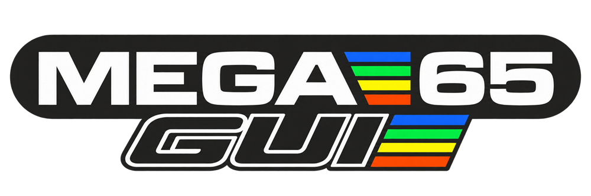
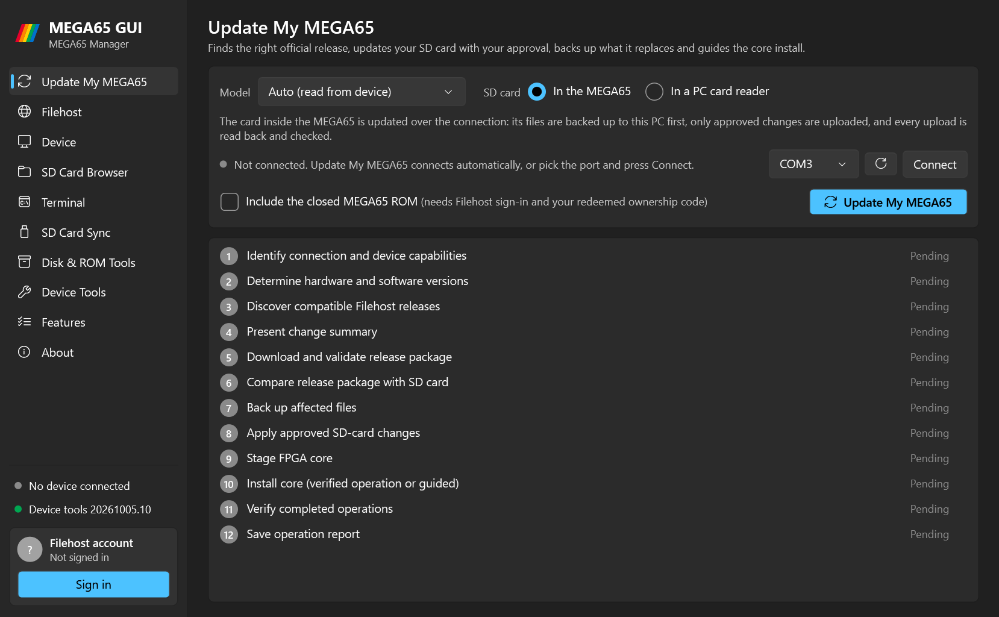
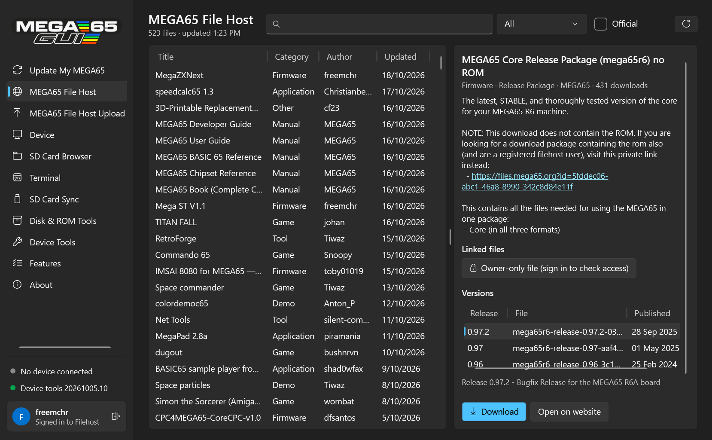
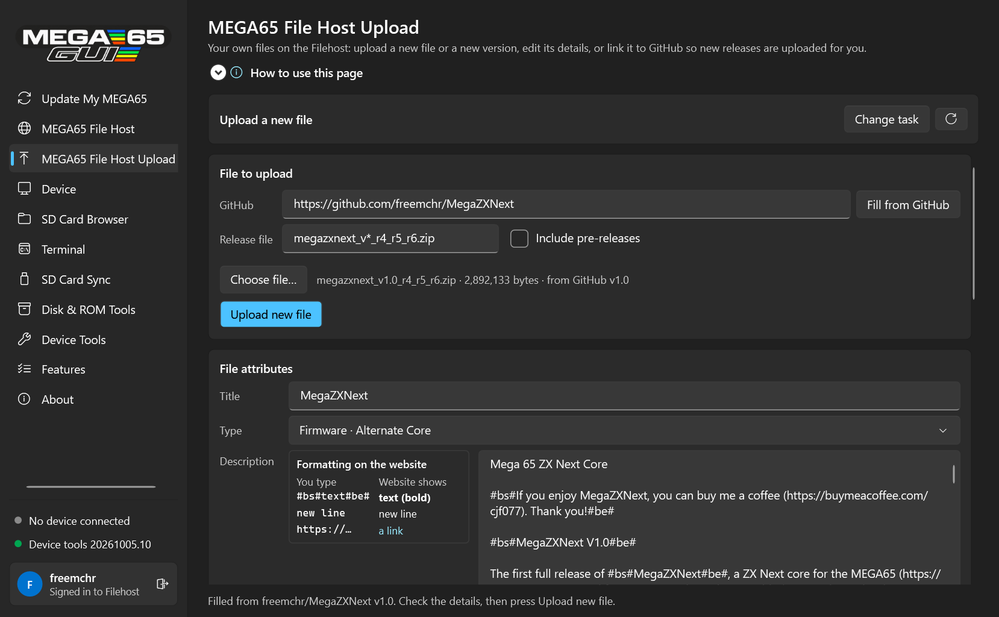
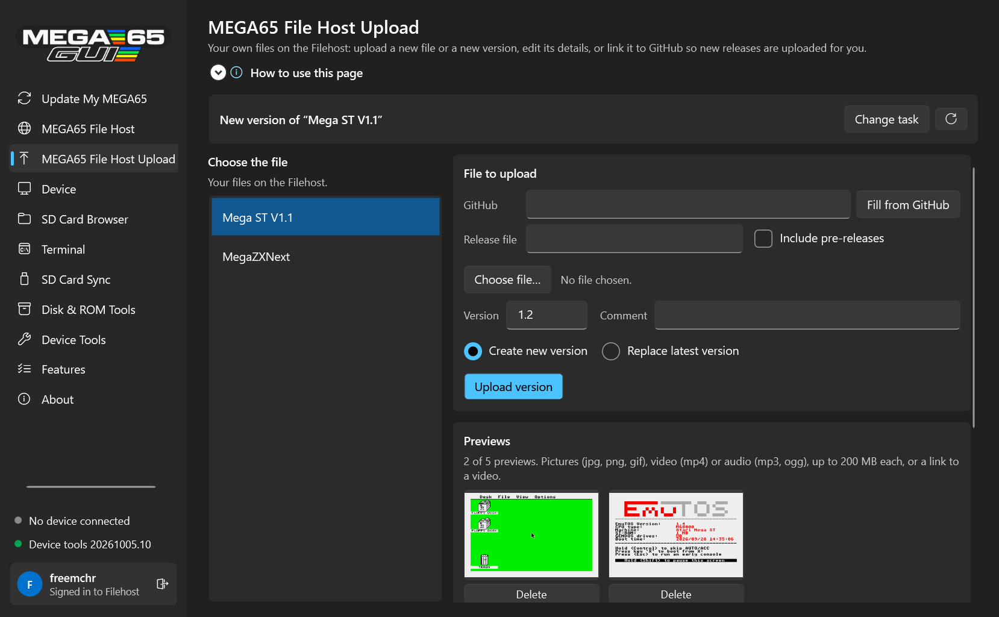
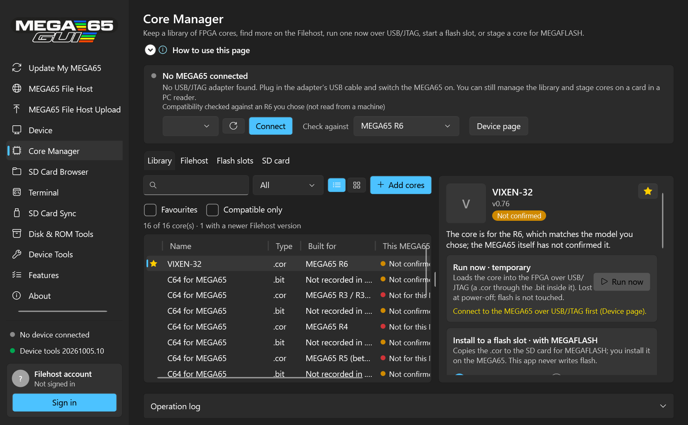
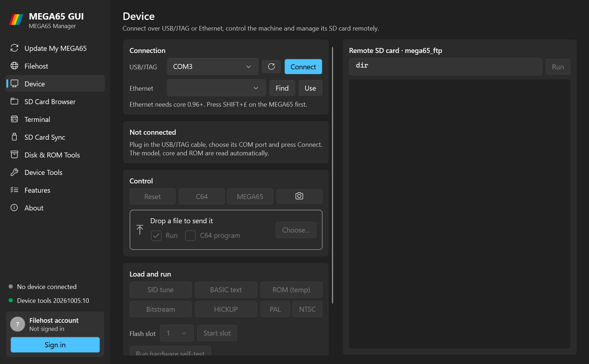
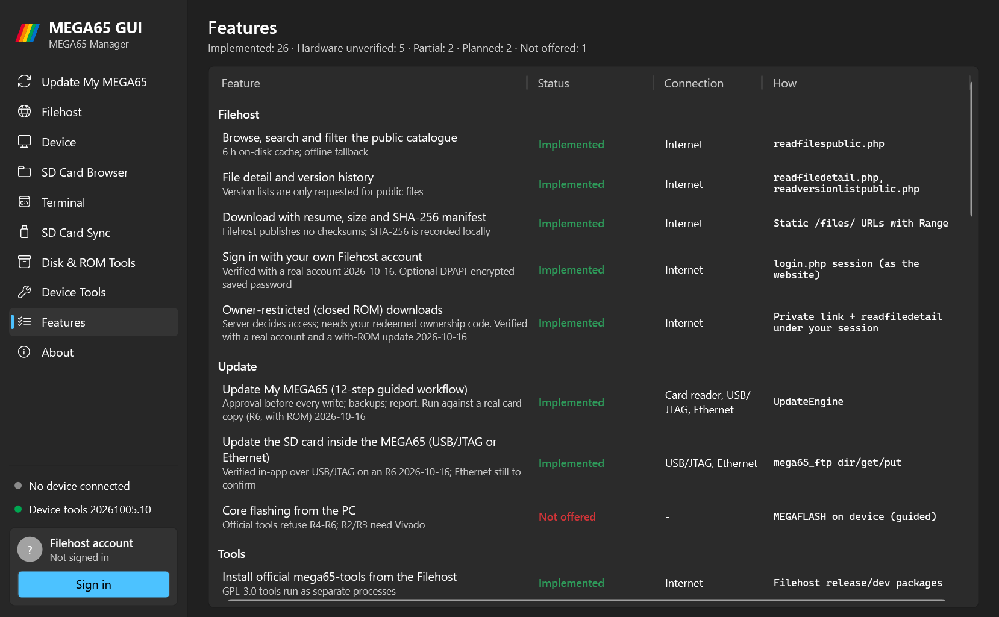

<h1 align="center"></h1>

Created by **Chris Freeman**.

[](https://buymeacoffee.com/cjf077)

**[Download the latest release](https://github.com/freemchr/mega65gui/releases/latest)**: unzip and run `Mega65Gui.exe` (Windows 10/11, 64-bit, nothing to install).

A Windows application for maintaining, updating and using a [MEGA65](https://mega65.org).

It brings together:
- the [MEGA65 Filehost](https://files.mega65.org);
- the official [mega65-tools](https://github.com/MEGA65/mega65-tools) (`m65`, `mega65_ftp`, `etherload`);
- a guided **Update My MEGA65** workflow;
- the working goal of feature parity with [M65Connect](https://github.com/MEGA65/m65connect).

> Status: **in development.** Tested on a real MEGA65 R6 over USB/JTAG: updates (including the closed ROM via your Filehost account), the SD card browser, PRG/SID/ROM/HICKUP loading, PAL/NTSC, screenshots, the terminal and remote keyboard, and running a core over JTAG from the Core Manager (Vixen-32). Ethernet is not yet verified on hardware. The app's Features page shows each feature's status.

## Screenshots

| | |
|---|---|
|  |  |
| **Update My MEGA65:** the 12-step guided update | **MEGA65 File Host:** browse, search and download |
|  |  |
| **File Host Upload:** a new file filled in from a GitHub release | **File Host Upload:** a new version, with previews |
|  |  |
| **Core Manager (new in 1.1):** a library of FPGA cores; run one over JTAG, start a slot, or stage it for MEGAFLASH | **Device:** connect, control and load files |
|  | |
| **Features:** what is implemented and verified | |

## What it does

### Update My MEGA65

1. Finds your model.
2. Picks the right official release from the Filehost.
3. Downloads and verifies it.
4. Compares it file by file with your SD card.
5. Backs up anything it will replace.
6. Writes only what you approve.
7. Stages the matching core for MEGAFLASH.
8. Verifies the result and saves a report.

### Filehost

- Search and browse all 520+ public files.
- Read details and version history.
- Download into a local cache that also works offline.
- Sign in with your own account to reach owner-only packages, such as releases that include the closed ROM.

### MEGA65 File Host Upload (for developers)

- Upload a new file, or a new version of one of your files, straight to the Filehost, with every field the website's My File Uploads has: title, type, description, search tags, short link, PAL/NTSC, platforms, access, core and ROM version, intro disk and highscore.
- **Fill from GitHub:** paste a repository link and the newest release is downloaded and filled in: title, description (release notes converted to the Filehost's format), suggested search tags, version and comment.
- **Sync from GitHub:** link a file to its repository and each new release is uploaded as a new version, optionally checked when the app starts.
- Add, view and delete previews (screenshots, video or audio, or a video link).
- A Website Preview shows the description as the Filehost will show it.
- You choose the task first, and nothing is uploaded or changed until you confirm.

### Core Manager

- Keep a library of FPGA cores (`.cor` and `.bit`, or a `.zip`/`.7z` containing them). Each file is checked (header, CRC32), stored once (SHA-256), and can have favourites, categories, tags, notes and artwork.
- Find alternate, arcade and official cores on the Filehost, download them into the library, and see when a newer version is published.
- Compatibility comes only from what a core's header says and what the MEGA65 reports. Boards named in file names are hints, and `.bit` files are never treated as confirmed.
- Three separate actions:
  - **Run now:** load a core temporarily over USB/JTAG. Nothing is written to flash.
  - **Start a flash slot:** restart from a slot. Nothing is written.
  - **Install to a flash slot:** copy the `.cor` to the SD card with approval, backup and verification, then follow the guided MEGAFLASH steps.
- Copy a core's own SD-card files (for example Vixen-32's `vixen-32` folder) to the card exactly as its package lays them out, with the same approval, backup and verification. If another core is running, the app asks you to switch the MEGA65 off and on, then reconnects and carries on.
- List the cores stored on the SD card. A core stored on the card is not installed: the MEGA65 cannot start a core from the card.
- Why the MEGA65 cannot start cores straight from its SD card, and what could get around the eight-slot limit: [Core loading feasibility](docs/CORE-LOADING-FEASIBILITY.md).

### Device

- Connect over USB/JTAG or Ethernet. Port lists name each COM port ("COM5 – MEGA65 USB/JTAG", "COM3 – Bluetooth (not a MEGA65)") and only pick one that could be the MEGA65.
- Reset, switch C64/MEGA65 mode, send PRGs (with drag-and-drop) and take screenshots.
- Run a `mega65_ftp` console for remote SD-card access.

### Tools

Installs the official mega65-tools builds from the Filehost.

### Help and new versions

- **Report a problem** (sidebar or About): shows the app's details (version, page, connection, COM ports, tools) and opens a GitHub issue with them filled in. Nothing is sent until you post it, and no passwords, tokens or account names are included.
- At start-up the app checks GitHub for a newer version and shows a link in the sidebar. Nothing is downloaded by itself; turn the check off on the About page.

## Safety

- **You approve every write.** Planning is read-only.
- **Nothing on your card is deleted.** Replaced files are backed up first.
- **FPGA flash is never written automatically.** The official tools cannot flash R4–R6 from a PC, so the app guides you through MEGAFLASH.
- **Uploads to the Filehost need your confirmation every time,** including GitHub syncs, and go only to your own files.
- **Owner-only Filehost downloads (the closed ROM) use your own Filehost account.** You sign in inside the app and the Filehost decides what you can download. Your password is never stored unless you ask, and then only DPAPI-encrypted.

## Documentation

- [Architecture](docs/ARCHITECTURE.md)
- [Filehost integration notes](docs/FILEHOST-API.md)
- [M65Connect feature parity](docs/M65CONNECT-PARITY.md)
- [Licensing review](docs/LICENSING.md)
- [Roadmap](docs/ROADMAP.md)
- [Releasing](docs/RELEASING.md)
- [Core loading feasibility (SD, flash slots, JTAG, Pico loader)](docs/CORE-LOADING-FEASIBILITY.md)

## Build

Requires the .NET 10 SDK on Windows.

```
dotnet test Mega65Gui.slnx
dotnet run --project src/Mega65Gui.App
```

## Support

- **Report a problem:** use **Report a problem** in the app, so the details come with it; or [GitHub Issues](https://github.com/freemchr/mega65gui/issues) for problems and feature requests.
- **Source and documentation:** https://github.com/freemchr/mega65gui
- **Support the project:** if MEGA65 GUI helps you, you can [buy me a coffee](https://buymeacoffee.com/cjf077).

## Credits

- **The official [MEGA65 tools](https://github.com/MEGA65/mega65-tools)** (`m65`, `mega65_ftp`, `etherload`, `romdiff`) by the MEGA65 project, GPL-3.0. MEGA65 GUI downloads them from the Filehost and runs them as separate programs.
- **The [MEGA65 Filehost](https://files.mega65.org):** releases, ROMs and software.
- **[M65Connect](https://github.com/MEGA65/m65connect)'s documentation:** used as a feature reference. No M65Connect code is included.
- **Libraries:** SharpCompress, CommunityToolkit.Mvvm and .NET, including System.Management (MIT).

MEGA65 GUI is an independent project and is not an official MEGA65 product.

## Licence

MEGA65 GUI is free software under the [GNU General Public License v3.0](LICENSE). Copyright © 2026 Chris Freeman.
